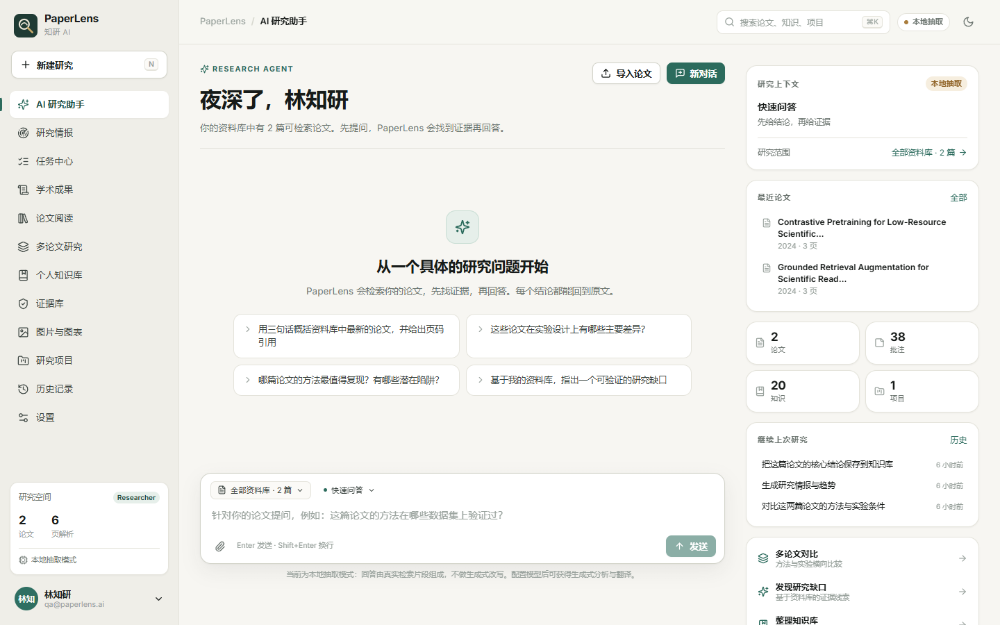
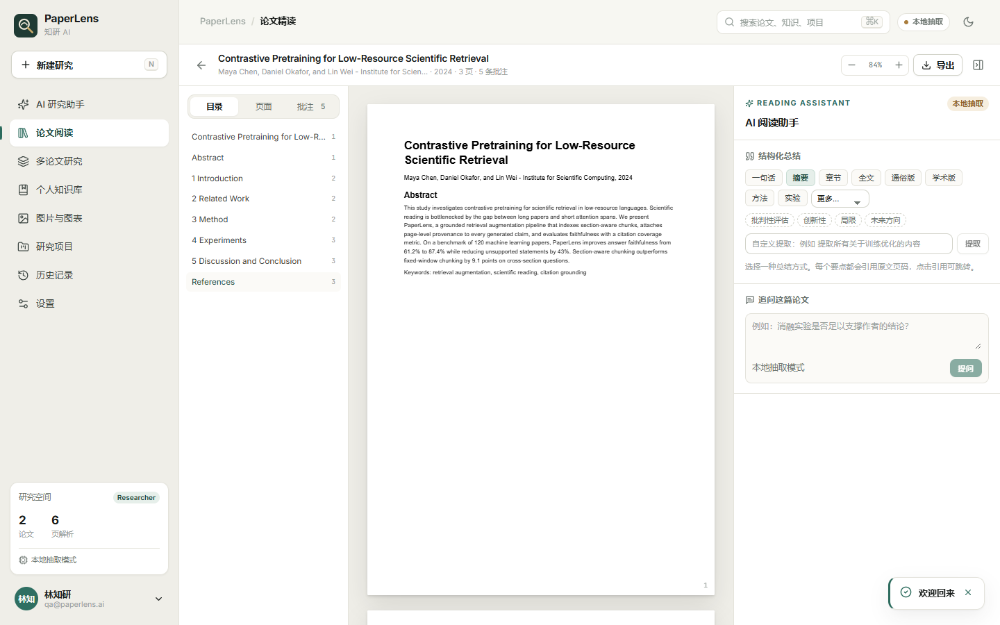
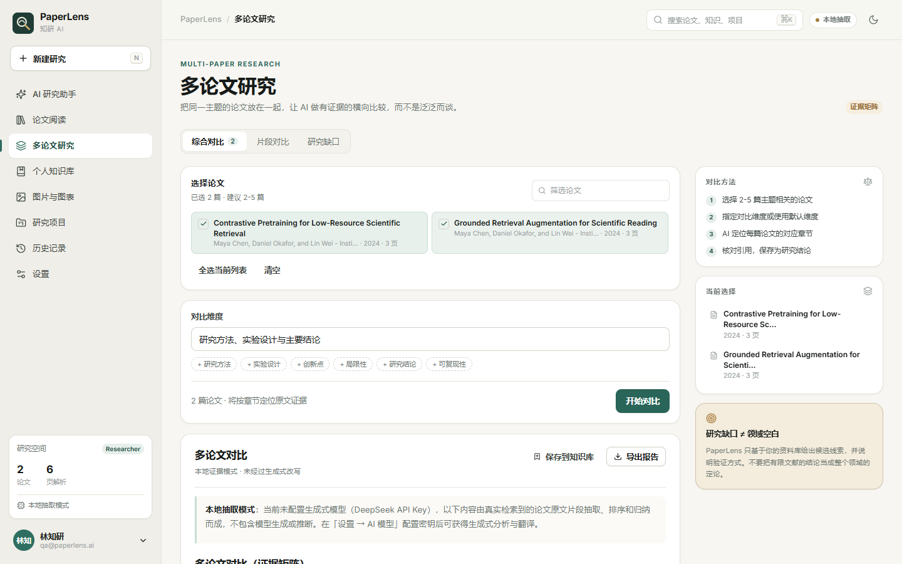
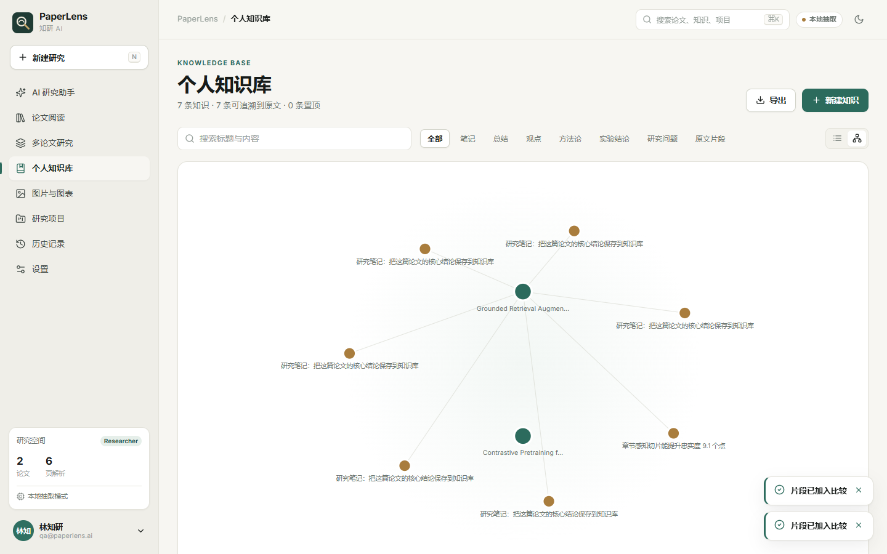
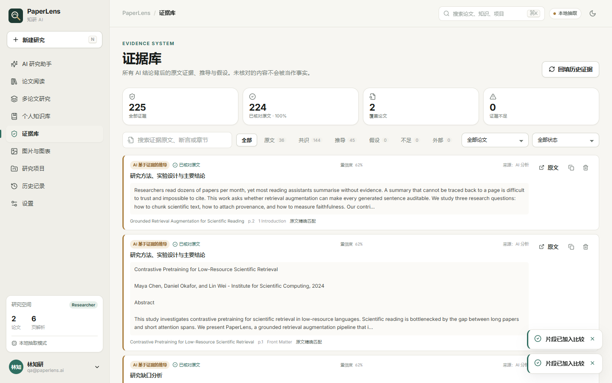
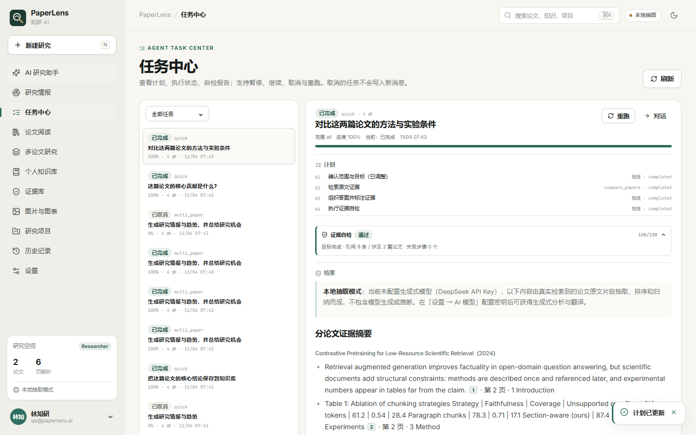
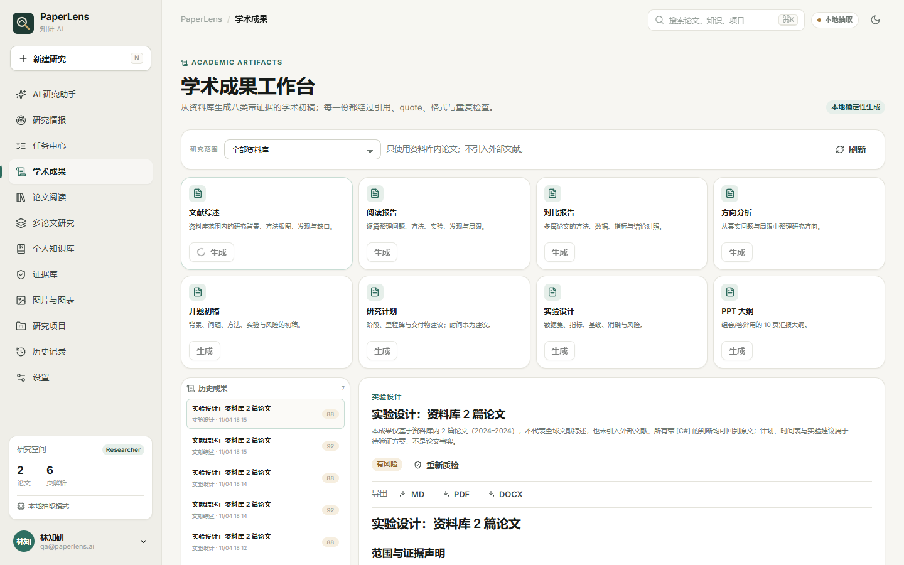

# PaperLens AI · 知研

**Your Personal AI Research Companion** — 一个以 AI Agent 为核心、所有结论都可追溯到论文原文的科研工作平台。

PaperLens 不是“又一个 PDF 聊天框”。它把 **PDF 解析 → 章节级检索 → 带引用的回答 → 批注/知识沉淀 → 多论文对比 → 长期项目** 放在同一条研究链路里；没有配置生成式模型时，也不会伪造 AI 输出，而是明确切换到基于真实原文的**本地抽取模式**。



## 部署

- **Railway（推荐）**：见 [deploy/RAILWAY.md](deploy/RAILWAY.md)
- **Docker Compose**：见 [docs/DEPLOYMENT.md](docs/DEPLOYMENT.md)
- 本机生产：`powershell -ExecutionPolicy Bypass -File deploy/start-production.ps1`
- 临时公网隧道、演示账号与本地数据不写入仓库；请部署后生成自己的 URL。

> 当前仓库是应用代码，不包含 SQLite 数据库、PDF、上传文件、密钥或测试截图。

## 界面预览

| 阅读器与批注 | 多论文对比 | 知识图谱 |
| --- | --- | --- |
|  |  |  |

| 证据库 | 任务中心 | 学术成果 |
| --- | --- | --- |
|  |  |  |

## 目录

- [它能做什么](#它能做什么)
- [快速开始](#快速开始)
- [环境变量](#环境变量)
- [测试](#测试)
- [部署](#部署)
- [项目结构](#项目结构)
- [能力边界（重要）](#能力边界重要)
- [文档](#文档)

## 它能做什么

| 模块 | 能力 | 状态 |
| --- | --- | --- |
| 认证与隔离 | 注册 / 登录 / JWT / 密码哈希 / 行级用户隔离 | ✅ |
| 论文解析 | PDF 上传、页/章节/段落/边界框、摘要、图表提取、表格文本、公式区域标记 | ✅ |
| 阅读器 | pdf.js 连续渲染、目录/页码导航、缩放、选中文字高亮 5 色、笔记、批注恢复 | ✅ |
| 可追溯问答 | Agent 先检索原文，再回答；[C1] 引用可跳转到 PDF 页码 | ✅ |
| Evidence System | 6 类证据、原文核验、置信度、证据抽屉、证据库、历史回填 | ✅ |
| 总结与分析 | 11 种总结模式、批判性评估、创新性/局限/未来方向、自定义提取 | ✅（生成式需 Key） |
| 翻译 | 选中/段落/页面翻译，双语对照，译文保存 | ✅（需 Key） |
| 多论文研究 | 综合对比、自选片段对比、研究缺口、资料库问答 | ✅ |
| P4 研究情报 | 六维证据矩阵、观点冲突、方法演化、缺口跨论文验证 | ✅ |
| P5 研究情报中心 | 资料库全景、趋势、知识关联、研究机会、项目范围 | ✅ |
| P6 Agent v2 | 计划预览/修改、暂停/继续/取消、自检、任务中心 | ✅ |
| P7 知识智能 | 自动标签、混合检索、去重、聚类、版本历史、合并 | ✅ |
| P8 学术成果 | 综述/报告/开题/计划/实验/PPT 大纲 + Quality Checker | ✅ |
| P9 性能与稳定 | 持久队列、增量缓存、限流、超时重试、备份恢复 | ✅ |
| V3.2 产品升级 | 修复 7 个信任缺陷、RI 缓存/可比性、Agent 恢复/规划、全局搜索/侧栏/阅读恢复、多文件批量上传 | ✅ |
| 知识库 | 知识片段、标签、来源页码、置顶、关联图谱、导出 | ✅ |
| 图表库 | 图表提取、预览、注释、收藏、AI 解释（文本依据） | ✅ |
| 研究项目 | 目标、进度、论文/笔记条目、项目导出 | ✅ |
| 导出 | PDF / DOCX / Markdown / TXT / CSV / JSON，真实文件下载 | ✅ |
| Agent 工具 | 15 个真实工具；写操作（保存知识/批注/导出）需用户确认 | ✅ |
| 部署 | Docker、Compose、Nginx、备份脚本、健康检查 | ✅ |

## 快速开始

### 方式 A：Docker（推荐）

```bash
cp .env.example .env
# 至少设置 PAPERLENS_SECRET_KEY（48 位随机字符串）与 DEEPSEEK_API_KEY（可选）
docker compose up -d --build
# 打开 http://localhost:8000
```

### 方式 B：本地开发

要求：Python 3.11+、Node.js 20+。

```bash
# 后端
cd backend
python -m venv .venv
# Windows: .venv\Scripts\activate   macOS/Linux: source .venv/bin/activate
pip install -r requirements.txt
python run.py            # http://127.0.0.1:8000

# 前端（另开终端）
cd frontend
npm install
npm run dev              # http://127.0.0.1:5173 ，已代理 /api
```

生产构建（由 FastAPI 直接托管前端）：

```bash
cd frontend && npm run build
cd ../backend && python run.py     # http://127.0.0.1:8000
```

### 可选：体验账号与示例数据

```bash
cd backend
$env:QA_PASSWORD="<your-demo-password>"
python scripts/qa_seed.py   # 生成示例账号与两篇 PDF；密码由 QA_PASSWORD 提供
```

> 该脚本只用于本地验收，**不会**在应用启动时自动执行。

## 环境变量

完整列表见 [`.env.example`](.env.example)。

| 变量 | 默认值 | 说明 |
| --- | --- | --- |
| `PAPERLENS_SECRET_KEY` | 开发用默认值 | JWT 签名；生产必须为 32+ 字符随机值 |
| `PAPERLENS_ENVIRONMENT` | `development` | `production` 时会强制校验密钥 |
| `PAPERLENS_DATABASE_URL` | `sqlite:///./data/paperlens.db` | 支持 PostgreSQL（`postgresql+psycopg://...`） |
| `PAPERLENS_STORAGE_DIR` | `./data/storage` | PDF/图表/导出文件目录 |
| `PAPERLENS_MAX_UPLOAD_MB` | `50` | 上传大小限制 |
| `DEEPSEEK_API_KEY` | 空 | 服务端默认模型密钥；也可由每个用户在设置中配置自己的 Key |
| `PAPERLENS_DEEPSEEK_BASE_URL` | `https://api.deepseek.com` | 任意 OpenAI 兼容端点 |
| `PAPERLENS_DEEPSEEK_MODEL` | `deepseek-chat` | 模型名 |
| `PAPERLENS_CORS_ORIGINS` | 本地开发地址 | 逗号分隔；生产禁止通配符 |

## 测试

```bash
# 后端（80 个用例）
cd backend && python -m pytest tests -q

# 前端类型检查 + 构建
cd frontend && npm run build

# 浏览器端到端验收（需先启动服务，Chrome 已安装）
cd qa && npm install && $env:QA_EMAIL="..."; $env:QA_PASSWORD="..."; node run.mjs
```

最近一次结果：

- 后端：**80 passed**
- 前端：TypeScript 严格模式构建通过
- 浏览器 QA：**38 个步骤全部通过，0 console/page error**（桌面 1440×900 + 移动 390×844）
- 独立 API 全流程：**88 / 88 通过**；搜索、侧栏折叠、阅读位置恢复、历史深链接额外通过
- 覆盖：登录 → 流式对话与引用 → 证据抽屉 → 阅读器 → 文字选择高亮 → 刷新恢复 → 批注转证据 → 总结与证据 → 批判性评估 → DOCX 下载 → 多论文对比 → 证据矩阵 → 观点冲突 → 方法演化 → 研究缺口与跨论文验证 → 片段对比 → 知识智能 → 证据库 → 研究情报 → Agent 计划与执行 → 任务中心 → 学术成果 + 质检 + 导出 → 图表 → 项目 → 历史 → 设置 → 深色主题 → 写操作确认 → 移动端（队列/限流由后端与 pytest 验证）

详见 [docs/TESTING.md](docs/TESTING.md) 与 [V3.2 升级报告](docs/V3.2_PRODUCT_UPGRADE.md)。

## 部署

### Railway（最简单）

1. Railway → New Project → Deploy from GitHub → 选择本仓库
2. 设置 `PAPERLENS_ENVIRONMENT=production`、`PAPERLENS_SECRET_KEY`（64 字符随机值）
3. 添加 Volume，挂载到 `/app/backend/data`（SQLite 与 PDF 必须持久化）
4. Generate Domain，访问 `/api/health`

完整变量与步骤见 [deploy/RAILWAY.md](deploy/RAILWAY.md)。

### Docker Compose

```bash
docker compose up -d --build
curl http://localhost:8000/api/health
```

生产清单、Nginx/TLS、PostgreSQL、备份与恢复见 [docs/DEPLOYMENT.md](docs/DEPLOYMENT.md)。

## 项目结构

```
paperlens-ai/
├── backend/
│   ├── app/
│   │   ├── main.py              # FastAPI 应用、SPA 托管、安全头
│   │   ├── models.py            # SQLAlchemy 模型（论文/切片/批注/知识/项目/对话）
│   │   ├── routers/             # auth / papers / annotations / figures / chat / research / library / exports / settings
│   │   └── services/            # PDF 解析、切片、检索、Agent、LLM、导出、存储
│   ├── scripts/                 # qa_seed / backup
│   └── tests/                   # pytest 端到端 API 测试
├── frontend/
│   └── src/
│       ├── pages/               # Home / Library / Reader / Research / Knowledge / Figures / Projects / Settings ...
│       ├── components/          # 设计系统、Markdown、Chat、上传器、阅读器
│       └── styles/              # 设计 Token 与响应式样式
├── qa/                          # Playwright 浏览器验收脚本与截图
├── deploy/nginx.conf
├── Dockerfile / docker-compose.yml
└── docs/
```

## 能力边界（重要）

PaperLens 明确区分“已实现”和“需要外部条件”：

1. **没有配置 DeepSeek API Key 时**：问答、总结、对比、研究缺口都使用**本地抽取模式**——只从真实检索片段中抽取、排序与并列证据，不生成新文本，并在界面明确标注。翻译与 AI 图表解释会返回可操作的错误提示，而不是假结果。
2. **模型不支持视觉输入**：图表解释基于图注与表格文本，不读取图像像素。
3. **检索是词法 + 字符 n-gram 混合索引**：不是神经向量检索；跨语言/强语义改写的问题建议使用论文中的术语。
4. **研究缺口是“候选线索”**：基于你的资料库，不等于对整个领域空白的判断。
5. **证据核验的是“引用是否在原文中”，不是“结论是否被证据支持”**；后者属于 Research Intelligence / 质量检查器的工作。
6. **所有生成式结论仍需回到原文核验**。

## 文档

- [产品说明与验收矩阵](docs/PRODUCT.md)
- [系统架构](docs/ARCHITECTURE.md)
- [API 参考](docs/API.md)
- [部署与运维](docs/DEPLOYMENT.md)
- [证据体系](docs/EVIDENCE.md)
- [多论文研究（P4）](docs/MULTIPAPER.md)
- [研究情报中心（P5）](docs/INTELLIGENCE.md)
- [Agent v2（P6）](docs/AGENT_V2.md)
- [知识智能（P7）](docs/KNOWLEDGE_INTELLIGENCE.md)
- [学术成果（P8）](docs/ARTIFACTS.md)
- [性能与稳定（P9）](docs/PERFORMANCE.md)
- [测试记录](docs/TESTING.md)
- [P3 实施报告](docs/V3.1_P3_REPORT.md)
- [P4 实施报告](docs/V3.1_P4_REPORT.md)
- [P5 实施报告](docs/V3.1_P5_REPORT.md)
- [P6 实施报告](docs/V3.1_P6_REPORT.md)
- [P7 实施报告](docs/V3.1_P7_REPORT.md)
- [P8 实施报告](docs/V3.1_P8_REPORT.md)
- [P9 实施报告](docs/V3.1_P9_REPORT.md)
- [V3.2 产品升级报告](docs/V3.2_PRODUCT_UPGRADE.md)
- [多文件全链路测试报告](qa/FULL_CHAIN_TEST_REPORT_2026-11-06.md)
- [部署报告](docs/DEPLOYMENT_REPORT.md)
- [安全说明](docs/SECURITY.md)