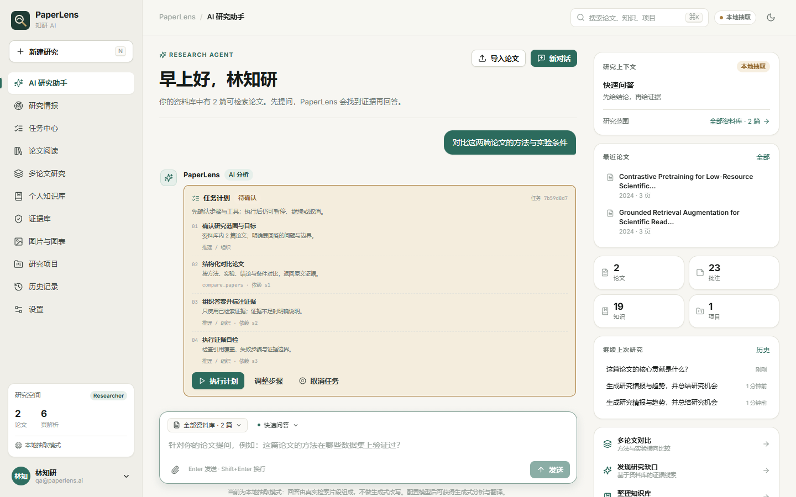
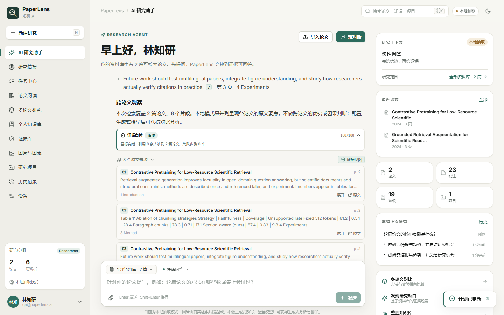
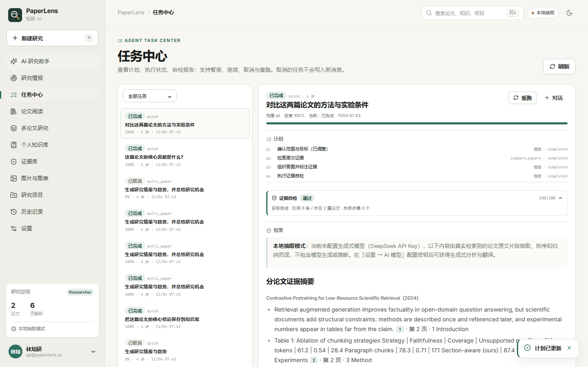

# Agent v2 · P6

> 2026-11-04 · 计划先行、可暂停/取消、自检、任务中心
> 目标：把“工具循环”升级成用户可控制的研究任务系统。



## 1. 为什么需要 P6

P6 前，Agent 的问题不是“不会调工具”，而是：

- 复杂任务直接开跑，用户看不到计划；
- 不能暂停/继续，只能断开浏览器；
- 取消只是客户端 abort，服务端状态不可查询；
- 没有自检，无法知道证据是否不足；
- 没有任务中心，历史任务不可重跑。

P6 解决的是**控制权**，不是再加一个聊天按钮。

## 2. 计划先行

复杂任务（深度阅读、批判、多论文，或包含“对比/报告/缺口/矩阵/演化/研究计划”等意图）会先返回计划：

- 步骤标题
- 调用的工具
- 依赖关系
- 每步说明

用户可：

- **执行计划**
- **调整步骤**（修改标题，保存后写回任务）
- **取消任务**

计划是确定性生成的，不假装是模型规划；它明确展示工具与依赖。
`/agent/tasks/plan` 只创建任务，不执行。

## 3. 任务状态机

```text
queued ──execute──▶ running ──pause──▶ paused
   │                    │  ▲              │
   │                    │  └──resume──────┘
   │                    ├──cancel──▶ cancelled
   │                    ├──complete──▶ completed
   │                    └──error─────▶ failed
   └──cancel──▶ cancelled
```

状态持久化在 `agent_tasks`：

- plan、plan_confirmed、progress、current_step
- self_check
- result_message_id
- rerun_of
- error / provider / timestamps

## 4. 暂停 / 继续 / 取消

### 暂停

- `POST /agent/tasks/{id}/pause`
- 任务状态立即变为 `paused`
- 执行器在检查点暂停：
  - 每个模型轮次前
  - 每个工具调用前
  - 每个流式片段前
- UI 收到 `paused` 事件，计划卡显示“已暂停”

### 继续

- `POST /agent/tasks/{id}/resume`
- 状态回到 `running`
- 同一个 SSE 连接继续，从当前检查点恢复
- UI 收到 `resumed`

### 取消

- `POST /agent/tasks/{id}/cancel`
- 状态变为 `cancelled`
- 执行器在下一个检查点抛出 `TaskCancelled`
- **不写 assistant message、不写证据、不写 usage**
- UI 收到 `cancelled`，不显示“重新生成”等操作

真实测试：

```text
pause 200 paused
paused event reached with 0 deltas before pause
resume 200 running
final completed
```

```text
cancel 200 cancelled
cancelled_event true
done_event false
result_message false
```

> 为了让人来得及点暂停，执行开始有 0.4s 的调度窗口；这不是伪造延迟，而是给 UI 注册控制信号的时间。

## 5. 自检

任务完成后生成 `self_check`：

- 目标是否完成
- 引用数量、涉及论文数
- 使用了但未返回的引用编号
- 失败的工具步骤
- 是否“提到冲突但证据不足两篇”
- 分数与结论：pass / warning / fail

自检是启发式的，不是 claim-level 事实验证；它在 UI 中明确标注。



## 6. 任务中心



- 历史任务列表，按状态筛选
- 计划与每步状态
- 当前步骤、进度
- 自检报告
- 执行 / 暂停 / 继续 / 取消 / 重跑
- 查看对话、查看证据

重跑会创建新任务并保留 `rerun_of`，不会覆盖原任务。

## 7. 工具升级

新增 `research_intelligence` 工具，可调用 P5 研究情报：

- landscape
- matrix
- conflicts
- evolution

Agent 仍只使用当前范围，不接外部文献。

## 8. API

| 方法 | 路径 | 说明 |
| --- | --- | --- |
| POST | `/agent/tasks/plan` | 只生成计划，不执行 |
| GET | `/agent/tasks` | 任务列表，可按 status 过滤 |
| GET | `/agent/tasks/{id}` | 任务、步骤、结果消息 |
| PATCH | `/agent/tasks/{id}/plan` | 修改计划（queued/paused） |
| POST | `/agent/tasks/{id}/execute` | SSE 执行 |
| POST | `/agent/tasks/{id}/pause` | 暂停 |
| POST | `/agent/tasks/{id}/resume` | 继续 |
| POST | `/agent/tasks/{id}/cancel` | 取消 |
| POST | `/agent/tasks/{id}/rerun` | 新任务重跑 |

SSE 新增事件：`plan` / `paused` / `resumed` / `cancelled` / `self_check`。

## 9. 验收

| 项 | 结果 |
| --- | --- |
| 后端测试 | **54 passed**（新增 5 个 P6 测试） |
| 浏览器 | **36 步通过**，0 console/page error |
| API | **102** |
| 数据表 | **26** |
| 任务 | 19 条 · 13 completed · 6 cancelled |
| 自检 | 13 条 |
| 证据 | 646 条，645 已核对 |
| 暂停 | 状态暂停、0 个 delta 先于 paused |
| 取消 | cancelled 事件、无 done、无结果消息 |

## 10. 已知边界

1. 暂停依赖 SSE 连接保持；刷新页面会丢失当前执行流，任务可能停在 paused。
2. 没有后台任务队列/断点续跑；长任务恢复属于后续阶段。
3. 计划是确定性模板，不是模型规划；复杂任务依赖用户调整。
4. 计划依赖只展示，不强制校验；工具顺序由执行器控制。
5. 自检是启发式，不检查每条 claim 的语义支持。
6. 暂停在长工具调用中要等工具返回后才生效。
7. 取消是协作式的；已经写出的部分流式文本会保留在客户端，但不会写库。
8. 没有多任务并行 UI；任务中心是顺序执行/重跑。

## 11. 下一步

P7 知识智能：自动标签、混合检索、重复检测、聚类、版本历史。
