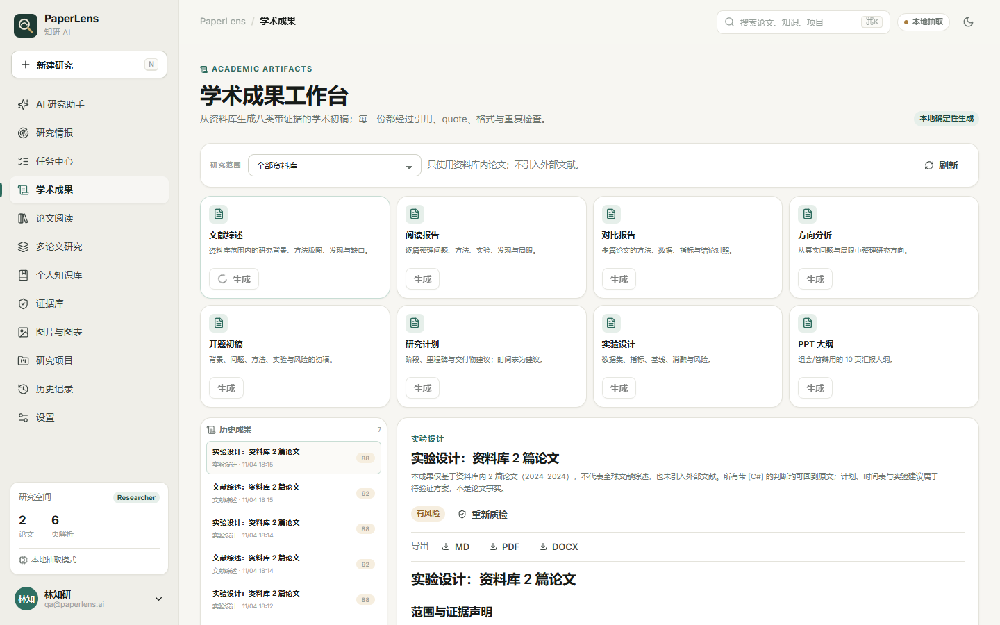
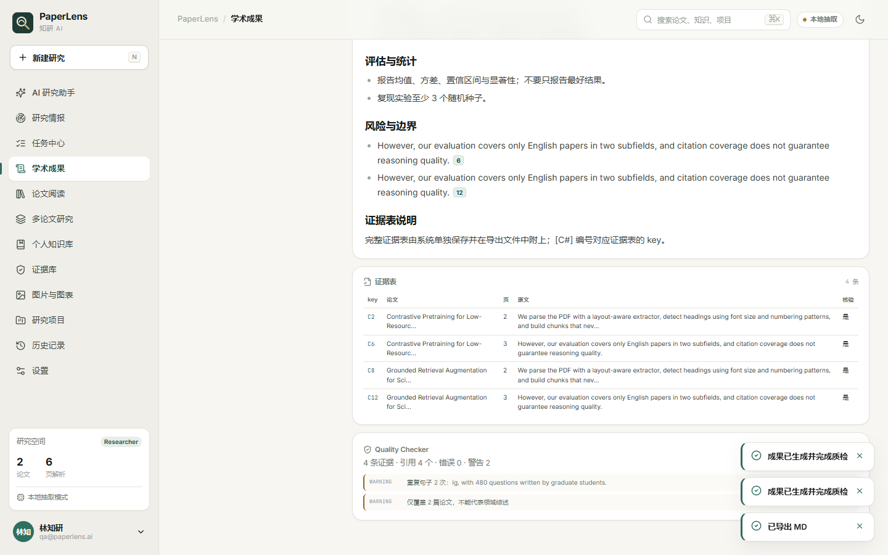

# 学术成果与 Quality Checker · P8

> 2026-11-04 · 八类学术初稿 + 证据表 + 范围声明 + 质检 + 导出
> 目标：生成“可交付的初稿”，同时让用户清楚它哪里不可靠。

## 1. 八类成果

| 类型 | 内容 |
| --- | --- |
| 文献综述 | 背景、方法版图、主要发现、局限/缺口、资料库内参考文献 |
| 阅读报告 | 逐篇问题、方法、数据、指标、发现、局限 |
| 对比报告 | 多篇方法/数据/指标/发现对照，条件边界 |
| 方向分析 | 真实问题与局限 → 候选方向 + 验证建议 |
| 开题初稿 | 背景、问题、方法、实验、预期贡献、风险 |
| 研究计划 | 阶段、里程碑、交付物、风险；时间表明确为建议 |
| 实验设计 | 数据、指标、基线、变量、消融、统计、风险 |
| PPT 大纲 | 10 页组会/答辩大纲 |

每份成果都包含：

- 范围与证据声明
- 正文中的 [C#] 引用
- 独立证据表（key / 论文 / 页码 / 原文 / 核验）
- 导出文件（MD / PDF / DOCX）

## 2. 生成原则

本地模式是**抽取式组合**，不是开放式编造：

- 问题/方法/数据/指标/发现/局限来自 P4 Facets；
- 每段实质内容尽量带原文引用；
- 计划、时间表、实验建议明确标注为“待验证方案”；
- 不生成外部参考文献，不补造论文；
- 资料库只有 2 篇时，明确提示“不能代表领域综述”。

模型 Key 即使存在，本阶段成果仍走确定性组合；避免把不可核验的生成文本包装成综述。

## 3. Quality Checker

检查项：

| 检查 | 规则 |
| --- | --- |
| 引用存在性 | 正文 [C#] 必须在证据表 |
| quote 对应 | 每条引用必须能在真实 chunk 中匹配 |
| 无依据推断 | 强断言（表明/证明/显著/优于）缺少引用 → warning |
| 重复 | 重复句子 → warning |
| 格式 | 必备章节、范围声明、证据表、篇幅 |
| 遗漏 | 缺少章节 → error |
| 范围 | 少于 3 篇 → warning |

输出：

- status: pass / warning / fail
- score: 0–100
- issues: code / severity / message / location
- summary: 证据数、引用数、错误/警告数

## 4. API

| 方法 | 路径 | 说明 |
| --- | --- | --- |
| GET | /artifacts/kinds | 八类成果元数据 |
| POST | /artifacts/generate | 生成 + 自动质检 |
| GET | /artifacts | 历史成果 |
| GET | /artifacts/{id} | 成果 + 最新质检 |
| POST | /artifacts/{id}/check | 重新质检 |
| POST | /artifacts/{id}/export | 导出 md/pdf/docx |
| DELETE | /artifacts/{id} | 删除 |

生成 body：

    {"kind": "literature_review", "scope_type": "all", "scope_id": null}

## 5. 验收（2026-11-04）

| 项 | 结果 |
| --- | --- |
| 后端测试 | **65 passed**（新增 4 个 P8 测试） |
| 浏览器 | **38 步通过**，0 console/page error |
| API | **114** |
| 数据表 | **30** |
| 八类成果 | pytest 每类生成一次，无 error 级质检问题 |
| 实际成果 | 9 份（QA 生成） |
| 质检报告 | 9 份；全部 warning（小样本/重复句） |
| 导出 | MD / PDF / DOCX 真实下载 |
| 证据 | **1086 条 / 1085 已核对 / 1 未核对** |

## 6. 已知边界

1. 本地成果是抽取式初稿，不是完整可投稿综述；需要研究者改写与补充。
2. 计划/时间表/实验方案是建议，不是已验证事实。
3. 质检是词法/结构启发式，不做 claim-level 语义支持验证。
4. 重复句检测是字符串级，可能漏掉改写重复。
5. 无外部文献；不能生成“全球综述”。
6. PPT 只生成大纲，不生成 .pptx。
7. 生成与质检为同步请求；大资料库需要队列（P9）。

## 7. 下一步

P9 性能与稳定：队列、增量索引、缓存、限流、备份、Postgres 实机验证。
