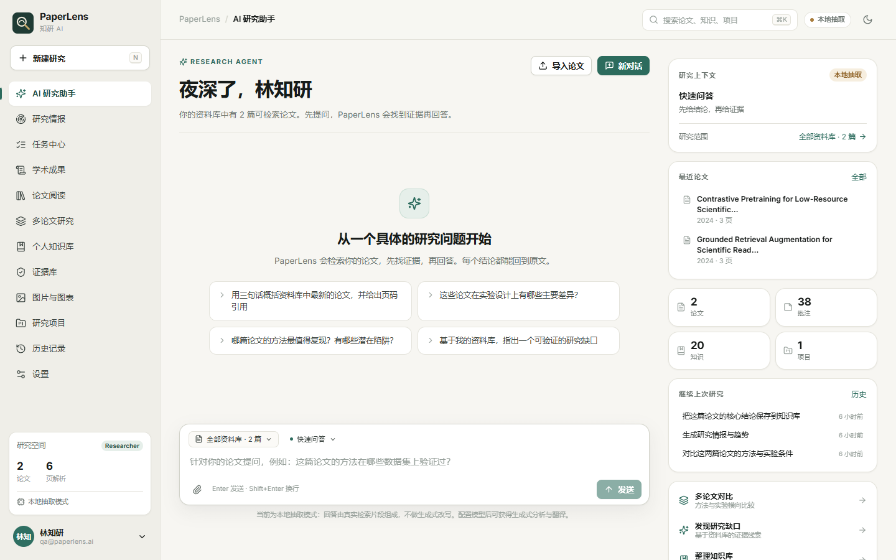

# 部署报告 · PaperLens AI

> 日期：2026-11-04
> 状态：production 实例运行中 + 临时公网隧道
> 结论：可用于演示与验收；**不是永久生产域名**，没有 SLA

## 1. 访问地址

| 范围 | 地址 | 说明 |
| --- | --- | --- |
| 本机 | http://127.0.0.1:8000 | production 模式，静态前端由 FastAPI 托管 |
| 局域网 | http://<LAN-IP>:8000 | 同一局域网可访问；防火墙可能需放行 |
| 公网（临时） | 已失效 | localhost.run 免费 SSH 隧道，仅用于当次验证 |

公网隧道特点：

- 进程停止即失效；重新启动会换 URL
- 首次加载约 30–60 秒（免费隧道带宽有限）
- 没有自定义域名、没有自己的 TLS 证书、没有 uptime 保证
- 登录账号不在文档中公开

## 2. 生产配置

- PAPERLENS_ENVIRONMENT=production
- PAPERLENS_SECRET_KEY：64 字符随机值，保存于 deploy/.env.production（已忽略）
- 数据库：SQLite backend/data/paperlens.db
- 存储：backend/data/storage
- 限流：120 请求/分钟，滑动窗口，429 + Retry-After
- 请求超时：300 秒
- 模型超时：180 秒；429/5xx 重试
- 静态资源 gzip：JS 1,250,855 → 370,538 bytes
- HSTS：max-age=31536000; includeSubDomains
- 安全头：X-Content-Type-Options / X-Frame-Options / Referrer-Policy / Permissions-Policy

启动命令：

    powershell -ExecutionPolicy Bypass -File deploy/start-production.ps1

停止：结束监听 8000 的 Python 进程；或使用 deploy/stop-production.ps1。

## 3. 部署前备份

    backups/pre-deploy.zip

- database_bytes: 7,507,968
- storage_files: 110
- zip bytes: 12,046,535
- database_sha256: 686cc24be458f2a468a5be6cdea4df5408be0deecacf40db737786e312bd163d

## 4. 验证记录

### 生产健康

    GET /api/health
    {"status":"ok","version":"0.9.0","environment":"production",...}

### 公网浏览器

- 打开登录页
- 登录 qa@paperlens.ai
- 进入 /app
- 侧栏最近论文 2 篇
- 0 console/page error
- 截图：screenshots/18-public-deploy.png

### 静态资源

    /assets/index-kSFrrlLK.js
    gzip: 370,538 bytes
    tunnel time: ~40s（免费隧道，首次加载）

### 数据

公网接口返回 QA 资料库 2 篇论文；本机同样 2 篇。

## 5. 已交付的部署资产

- Dockerfile（Node 构建 + Python 运行 + 健康检查）
- docker-compose.yml（数据卷、env_file、restart）
- deploy/nginx.conf（反代、SSE、55MB 上传）
- deploy/cloudflared.example.yml（命名隧道模板）
- deploy/start-production.ps1
- deploy/.env.production.example
- deploy/README.md
- scripts/backup.py

## 6. 没有做到 / 不能声称

1. **没有永久公网域名**：当前只是 localhost.run 临时隧道。
2. **没有自己的 TLS 证书**：TLS 由隧道服务终止。
3. **Docker 未在本机执行**：本机没有 Docker；Dockerfile/compose 未实跑。
4. **Postgres 未实机验证**：没有 psql/Docker/Postgres 服务。
5. **没有多实例/队列集群**：单进程单 worker，SQLite 单写。
6. **公网注册开放**：任何访问者可注册新账号；数据隔离仍然有效，但公开演示不应放入真实敏感资料。
7. **首次加载慢**：免费隧道带宽有限，1.25MB JS gzip 后仍需约 40 秒。
8. **隧道重启换 URL**：需要重新获取。

## 7. 永久部署建议

1. 一台有公网 IP 的 VPS（2C4G 起）。
2. 域名 A 记录 + Caddy/Nginx + Let's Encrypt TLS。
3. Docker Compose 或 systemd 运行，restart unless-stopped。
4. 数据卷持久化 + 每日备份 + 恢复演练。
5. 生产 PostgreSQL（pg_dump），或至少 SQLite 单实例 + 定时快照。
6. 关闭公网注册或加邀请码（当前未实现）。
7. 多实例时把队列迁移到 Redis/Celery，限流迁移到共享存储。
8. 监控 /api/health、/api/ops/metrics、磁盘与错误日志。

## 8. 演示建议

- 现场演示优先用本机/局域网，避免免费隧道带宽影响。
- 需要远程评审时再发公网 URL，并告知首次加载较慢。
- 演示账号与数据不要写入公开仓库。

