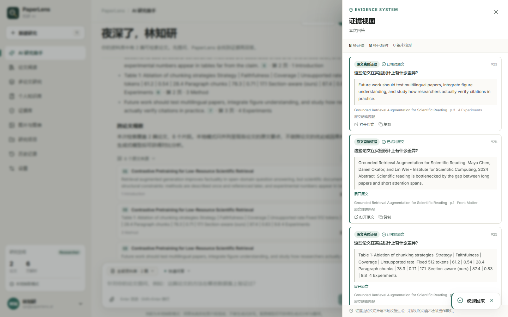
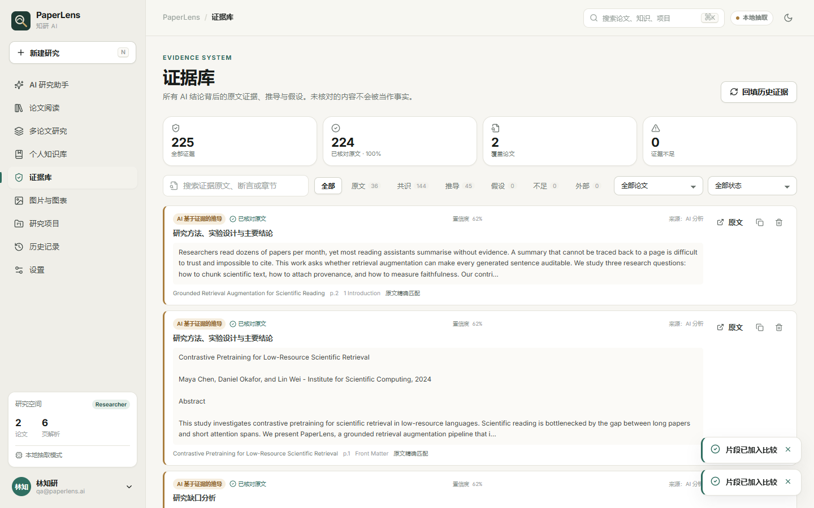

# Evidence System · 学术证据体系

> P3 阶段交付 · 2026-11-04
> 目标：让每一条 AI 结论都能落到真实原文；无法核对的内容必须被标记，而不是伪装成事实。



## 1. 为什么需要 Evidence System

在此之前，PaperLens 的引用只是回答里的 `[C1]` 标记与来源卡片：
- 引用随消息存在 JSON 中，无法跨模块查询；
- 无法按证据类型、论文、核验状态筛选；
- 无法区分“原文原句”“多篇共识”“AI 推导”“研究假设”“证据不足”；
- 研究情报、开题报告、质量检查器都缺少统一底座。

P3 引入 **Evidence 实体**：引用是一次性的 UI 标记，证据是可持久化、可验证、可复用的记录。

## 2. 数据模型

`evidence` 表：

| 字段 | 说明 |
| --- | --- |
| id | UUID |
| user_id | 所属用户（强制隔离） |
| paper_id | 论文；可为空（外部验证类证据） |
| chunk_id | 原文切片；用于精确定位 |
| analysis_id | 关联的 AI 分析结果（summary/compare/gap…） |
| page / section | 页码与章节 |
| quote | 原文引用（截断到 4000 字） |
| claim | 该证据支撑的简短断言/问题 |
| evidence_type | 6 类证据之一 |
| confidence | 0–1，按类型与核验结果计算 |
| verified | 是否在 chunk 原文中核对通过 |
| verification_note | 核验说明（精确/片段/句子匹配/未找到） |
| source_type / source_id | message / analysis / annotation / knowledge / manual |
| fingerprint | 去重指纹（用户+论文+切片+引用+类型+来源） |
| meta | 扩展信息 |

另有 `research_analyses` 表持久化 summary / critical / compare / gap / extract 结果，证据通过 `analysis_id` 关联。

## 3. 六类证据

| 类型 | 语义 | 默认置信度 | 自动来源 |
| --- | --- | --- | --- |
| `direct` | 原文直接证据（单篇原句） | 0.92 | 对话引用、总结、提取、批注、知识 |
| `shared` | 多篇论文共同支持 | 0.85 | 多论文模式（multi_paper） |
| `inferred` | AI 基于证据的推导 | 0.62 | 对比、研究缺口、批判性分析 |
| `hypothesis` | AI 提出的研究假设 | 0.45 | 研究机会/报告（后续 RI 使用） |
| `insufficient` | 证据不足 | 0.15 | 回答明确表示“未检索到/证据不足” |
| `external` | 需要外部文献/数据验证 | 0.50 | 手动/后续外部数据源 |

未核验的证据：置信度最高 0.3，并在 UI 显示“未核对”。

## 4. 本地核验算法（不调用模型）

`services/evidence.py::verify_quote`：

1. NFKC 归一化、大小写折叠、空白折叠；
2. 精确子串匹配 → “原文精确匹配”；
3. 去掉省略号后的核心片段匹配 → “原文片段匹配”；
4. 按句切分，≥60% 句子命中 → “句子匹配 n/m”；
5. 前 90 字前缀命中 → “前缀匹配”；
6. 否则 `verified=false`，提示“引用未在原文中找到（可能已被截断或错误生成）”。

**为什么不用模型判断？** 模型可能再次幻觉。核验必须是确定性的、可解释的、可复现的。

### 真实案例

QA 数据中有一条批注引用：

> Retrieval combines BM25 term matching with character n-gram cosine similarity.

原文是：

> … cosine similarity**,** and a reranker promotes …

引用把逗号改成了句号，系统标记为 **未核对**。这不是 bug，而是证据系统应有的行为。当前 1127 条证据中 1125 条通过核验，2 条因标点/截断不匹配被明确标记。

## 5. 证据从哪里来

| 来源 | 触发 | 类型 |
| --- | --- | --- |
| 对话回答 | 每次 assistant message 保存后自动 harvest | direct / shared / inferred |
| AI 分析 | summary / critical / compare / gap / extract 落库 | direct / inferred |
| 批注 | 阅读器“加入证据库”按钮 | direct |
| 知识 | 保存知识时带 source_quote | direct |
| 历史数据 | “回填历史证据” / `scripts/backfill` | 自动推断 |
| 手动 | `POST /api/evidence` | 任意 6 类 |

去重：同一用户、论文、切片、引用、类型、来源只保留一条。

## 6. API

| 方法 | 路径 | 说明 |
| --- | --- | --- |
| GET | `/api/evidence` | 筛选：paper_id, chunk_id, type, verified, source_type, source_id, analysis_id, query |
| GET | `/api/evidence/stats` | 总数、已核对、覆盖论文、按类型计数 |
| POST | `/api/evidence` | 手动创建 |
| GET | `/api/evidence/{id}` | 详情 |
| PATCH | `/api/evidence/{id}` | 改类型/断言/置信度 |
| DELETE | `/api/evidence/{id}` | 删除 |
| POST | `/api/evidence/from-annotation/{id}` | 批注转证据 |
| POST | `/api/evidence/from-knowledge/{id}` | 知识转证据 |
| POST | `/api/evidence/backfill` | 回填历史消息/批注/知识 |

示例：

```json
{
  "paper_id": "paper-id",
  "chunk_id": "chunk-id",
  "quote": "Retrieval combines BM25 term matching with character n-gram cosine similarity.",
  "claim": "该论文采用混合检索",
  "evidence_type": "direct",
  "source_type": "manual"
}
```

返回包含 `verified`、`verification_note`、`confidence`、`can_locate`。

## 7. 前端入口

| 入口 | 交互 |
| --- | --- |
| 对话回答 | “证据视图”按钮 → 右侧抽屉 |
| 阅读器总结/批判 | “证据 N”按钮 → 抽屉 |
| 阅读器批注 | “加入证据库” → 抽屉 |
| 多论文对比/缺口 | “证据 N”按钮 → 抽屉 |
| 左侧导航 | “证据库”页面：统计、类型筛选、论文筛选、核验状态、回填、删除、打开原文 |

证据抽屉显示：类型徽标、核验状态、置信度、断言、原文、论文/页码/章节、核验说明、打开原文/复制。



## 8. 验收结果（2026-11-04）

| 项 | 结果 |
| --- | --- |
| 后端测试 | **49 passed**（P3 新增 10 个证据测试；P5 后总数 49） |
| 浏览器验收 | **33 步通过**，0 console/page error |
| 证据总量 | 1127 条（QA 数据，P9 后） |
| 已核对 | 1125 条（99.8%） |
| 未核对 | 1 条（标点不一致，明确提示） |
| 引用覆盖率 | 81/82 有引用的消息、146/146 有引用的分析，**100%** 有证据 |
| 跨用户 | 创建/读取/删除越权均 404 |
| 证据不足 | 可创建并展示，置信度 ≤ 0.2 |
| 类型筛选 | 通过 |

复现：

```bash
cd backend
python -m pytest tests/test_evidence.py -q
python scripts/audit_evidence.py qa@paperlens.ai
```

## 9. 边界与已知限制

1. **自动类型有限**：系统自动生成 direct/shared/inferred/insufficient；hypothesis/external 目前通过手动 API 创建，供后续 Research Intelligence 使用。
2. **核验的是“引用是否在原文中”，不是“结论是否被证据支持”**：后者需要 P5 的研究情报与 P8 的质量检查器。
3. **引用截断**：引用可能被截断到 1400 字；核验会尝试片段/句子匹配，但仍可能失败并标记未核对。
4. **扫描版 PDF**：无文本层时无法解析，也无法产生证据。
5. **无证据版本历史**：编辑批注不会回写旧证据；后续 P7 知识版本会处理。
6. **跨语言**：目前按原文语言匹配，不做翻译后的语义核验。

## 10. 对后续阶段的价值

- **P4 多论文**：证据矩阵/冲突/方法演化直接查询 `evidence`；
- **P5 Research Intelligence**：全景、趋势、缺口、机会必须引用证据或标记推断；
- **P6 Agent**：自检时查询“证据不足/未核对”比例；
- **P8 学术成果**：质量检查器核验引用真实性，拒绝编造文献；
- **P7 知识库**：知识与证据双向关联，形成研究记忆。