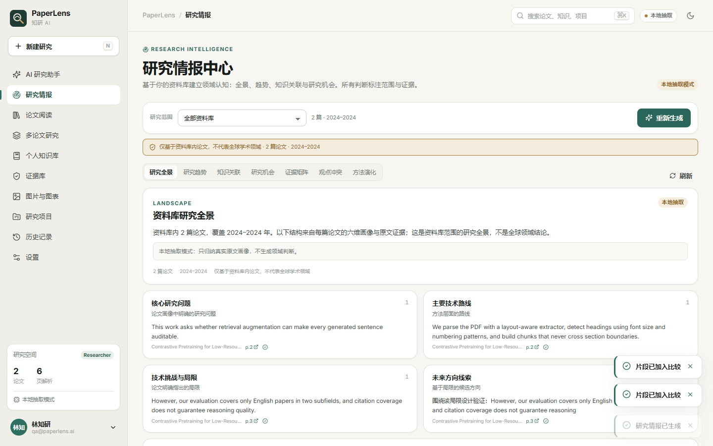
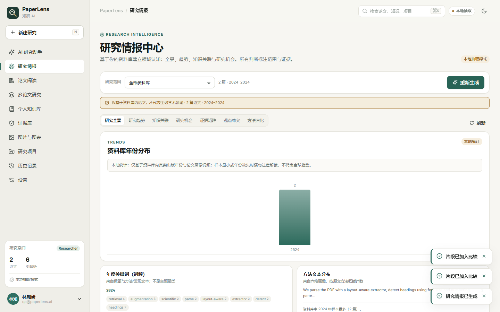
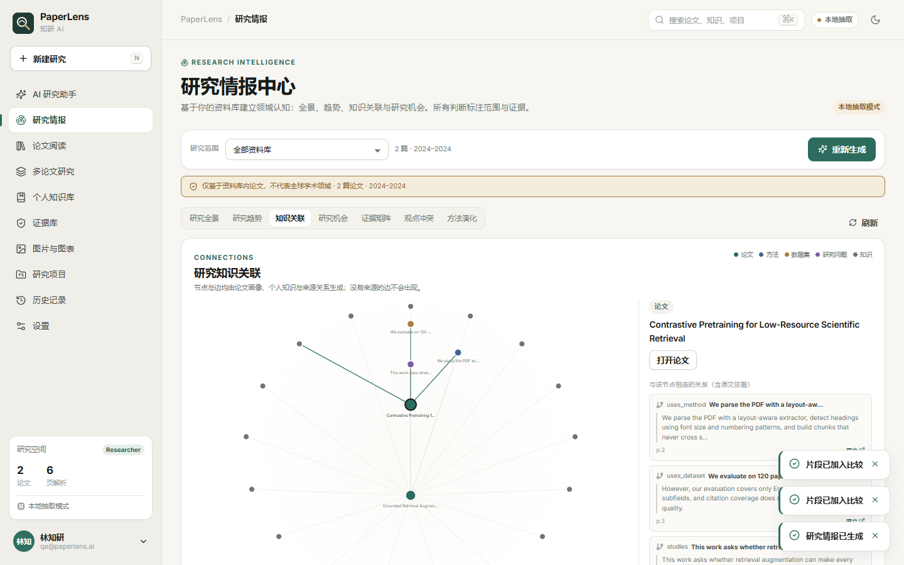
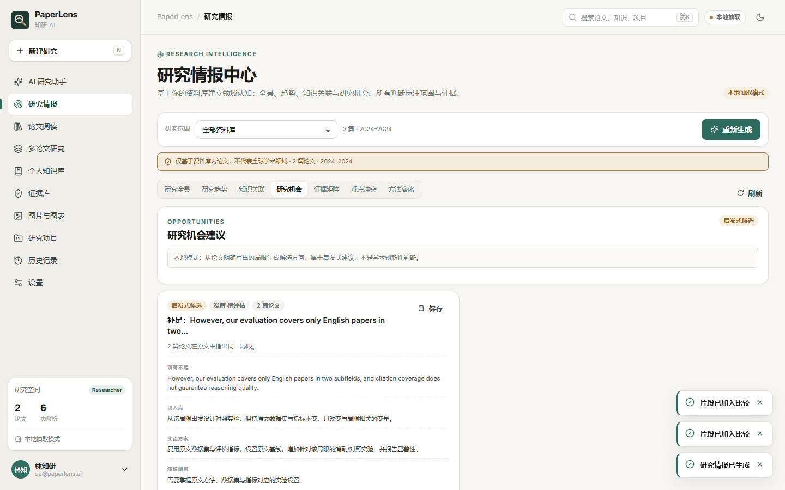

# 研究情报中心 · P5

> 2026-11-04 · Research Intelligence，基于 P3 Evidence / P4 PaperFacet
> 目标：把资料库变成可解释的领域认知，而不是给用户一份“看起来很全”的领域报告。



## 1. 产品定位

PaperLens 的研究情报只在**用户资料库**内工作：

- 全部资料库
- 某个项目
- 某个合集

没有接入外部学术数据库之前，页面不会声称“全球领域趋势”。所有页面顶部/范围条都显示：

```text
仅基于资料库内论文，不代表全球学术领域 · N 篇论文 · 年份范围
```

这是 P5 的核心边界：**资料库智能 ≠ 全球文献情报**。

## 2. 四个模块

### 2.1 研究全景（Landscape）

- 核心研究问题
- 主要技术路线
- 关键方法
- 代表性论文
- 技术挑战与局限
- 未来方向线索

每条都带论文、页码、原文与核验状态。本地模式只归纳 Facets，不生成领域判断；生成式模式要求每条带证据编号。

### 2.2 研究趋势（Trends）

- 真实出版年份分布（不补造年份）
- 年度关键词词频（来自标题/方法/发现文本）
- 方法文本分布
- 样本量、年份缺失提示

明确写“样本统计，不代表全球趋势”。没有做主题聚类，因此不把词频包装成“研究热点”。



### 2.3 知识关联（Connections）

节点：

- 论文
- 方法
- 数据集
- 研究问题
- 个人知识

边：

- 论文 —uses_method→ 方法
- 论文 —uses_dataset→ 数据集
- 论文 —studies→ 研究问题
- 知识 —derived_from→ 论文

每条边都有来源依据（页码/原文），没有依据的边不会出现。点击节点查看关联与原文。



### 2.4 研究机会（Opportunities）

本地模式：

- 只从论文**明确写出的局限**生成候选；
- 同一局限跨论文合并为一张卡；
- 给出背景、现有不足、切入点、实验方案、知识储备、风险；
- 明确标注“启发式候选，不保证创新性/可发表”。

生成式模式：

- 严格 JSON；
- 每条必须有证据；
- 标注 AI 建议与不确定性。



## 3. 缓存与范围

- 结果存入 `intelligence_reports`；
- 同一 scope + 同一论文集合可复用缓存；
- `force=true` 重新生成；
- 项目/合集范围独立，不串数据；
- 跨用户不可见（404）。

## 4. API

| 方法 | 路径 | 说明 |
| --- | --- | --- |
| GET | `/intelligence/scope` | 解析范围；返回论文、年份、边界 |
| POST | `/intelligence/overview` | 生成/复用四类报告；body: `scope_type, scope_id, force` |
| GET | `/intelligence/reports` | 历史报告，可按 kind/scope 过滤 |
| GET | `/intelligence/reports/{id}` | 单份报告 |

`scope_type`：`all | collection | project | papers`。

## 5. 验收结果（2026-11-04）

| 项 | 结果 |
| --- | --- |
| 后端测试 | **49 passed**（新增 6 个 P5 测试） |
| 浏览器 | **33 步通过**，0 console/page error |
| 范围 | 全部资料库 2 篇，2024 |
| Landscape | 问题/方法/挑战/未来方向均有原文页码 |
| Trends | 1 个年份、1 组关键词、方法分布；明确样本边界 |
| Connections | 18 节点 / 19 边；边带 basis |
| Opportunities | 同一局限合并为 1 张卡，标注启发式 |
| 报告 | 28 条（QA 反复生成，4 类 × 7） |
| 证据 | 478 条，477 已核对，1 条标点差异未核对 |
| 隔离 | 跨用户报告 404 |

复现：

```bash
cd backend
python -m pytest tests/test_intelligence.py -q
```

## 6. 已知边界

1. 不接入外部学术数据；不能回答“这个领域全球在做什么”。
2. 趋势是资料库样本统计，不是主题聚类/热度指数。
3. 研究机会是启发式/生成式建议，不保证创新性、可行性或可发表。
4. 本地 Facets 是规则抽取，复杂论文可能字段不准；生成式仍需 quote 核验。
5. 连接图只表达已记录关系，不推断未写出的学术传承。
6. 大资料库（>60 篇）当前截断；需要分页/增量索引（P9）。
7. 无模型 Key 时，冲突/演化关系/生成式全景不会出现；UI 会明确标注本地模式。

## 7. 下一步

P6 Agent v2：让研究助手能调用这些情报能力，而不是只做问答。