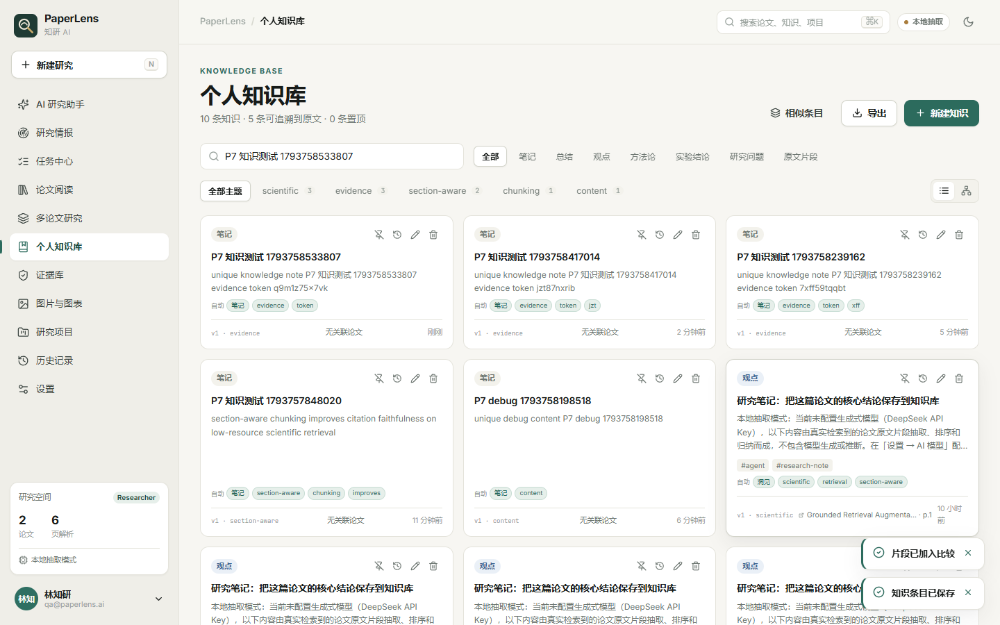
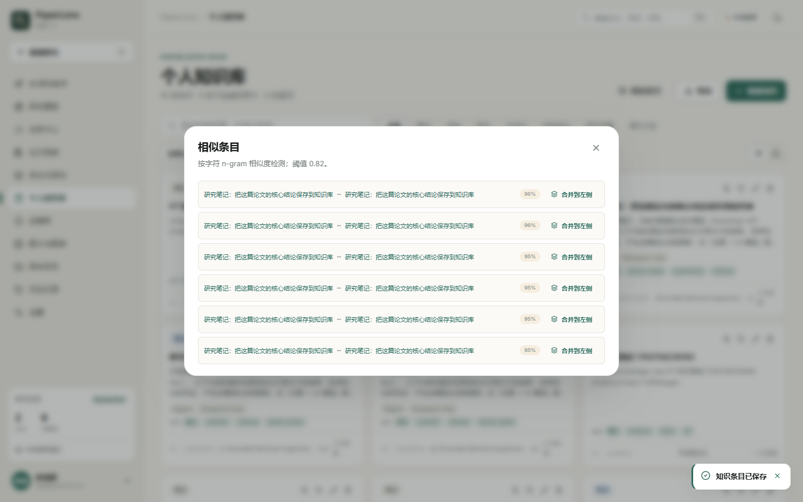
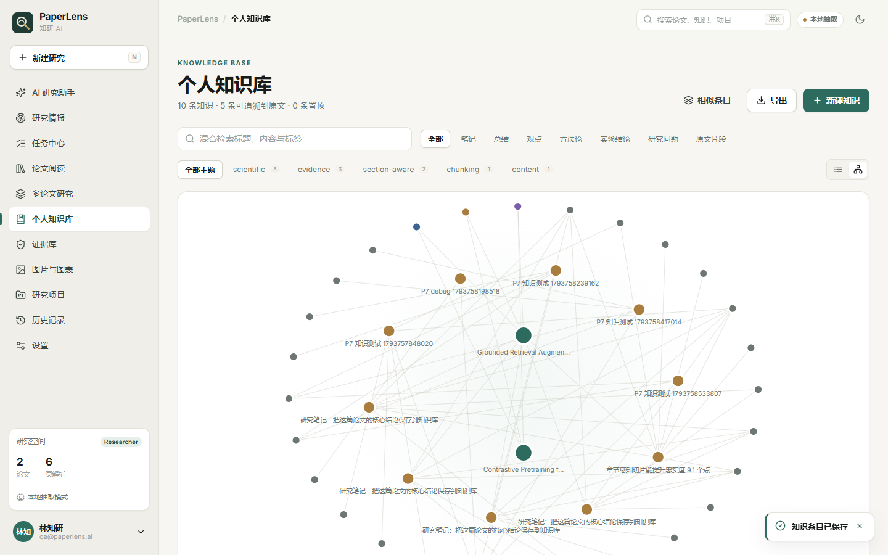

# 知识智能 · P7

> 2026-11-04 · 自动标签、混合检索、去重、聚类、版本历史
> 目标：让知识库从“存储”变成可检索、可去重、可回溯的研究记忆。

## 1. 自动标签

保存知识时自动生成两类标签：

1. **来源/结构标签**：来自来源 chunk 的 `method` / `experiment` / `limitation` 等，以及章节标题；
2. **关键词标签**：英文术语（BM25 同款分词）+ 已知中文学术词 + 类型标签。

自动标签与手动标签分开显示，不覆盖用户输入。

**边界**：这是规则抽取，不是模型语义理解；不会为没有来源的笔记编造方法/数据集标签。

## 2. 混合检索

`GET /knowledge?query=...` 现在使用：

- BM25 词项匹配
- 字符 trigram 余弦
- 标题/标签加权
- 精确子串加分

与论文检索共用 `HybridIndex`，离线、确定性、支持中英混合。

返回每条结果的 `search_score`；项目/类型/标签/主题筛选先过滤再检索。

**边界**：没有神经嵌入；不是“语义理解”，是混合词法检索。

## 3. 重复检测

- 字符 n-gram 余弦相似度，默认阈值 **0.82**
- 创建时命中阈值：返回 **409 duplicate_knowledge**，不创建新条目
- 用户明确“仍然保存”时传 `force=true`，记录 `duplicate_of`
- 相似条目面板列出所有对，可查看并合并
- Agent 的 `save_knowledge` 遇到相似内容：生成“需确认”的写操作，而不是静默重复

## 4. 版本历史

每次编辑生成新版本（append-only）：

- 创建：v1
- 编辑：v2, v3...
- 回滚：不覆盖历史，而是生成新版本，`note` 记录回滚目标
- 版本保存：标题、内容、类型、标签、变更字段、时间、备注

`GET /knowledge/{id}/versions` 查看；`POST .../versions/{version}/rollback` 回滚。
合并相似条目也会生成新版本。

## 5. 聚类

按自动标签与类型做确定性聚类：

- 优先“方法 / 数据集 / 研究问题 / 局限 / 实验 / 结论”
- 否则取第一个非通用关键词
- 返回 cluster key/label/count/item_ids

这是**标签聚类**，不是语义主题模型；页面明确显示“主题”而不是“AI 主题”。

## 6. 知识图谱

新增节点：

- 标签（自动标签）
- 方法 / 数据集 / 研究问题（来自 P4 PaperFacet）

边：

- knowledge —tagged→ tag
- paper —uses_method→ method
- paper —uses_dataset→ dataset
- paper —studies→ question
- knowledge —derived_from→ paper

所有边来自实际记录，不推断未写出的关系。

## 7. API

| 方法 | 路径 | 说明 |
| --- | --- | --- |
| GET | `/knowledge?query=&cluster=` | 混合检索 / 主题过滤 |
| POST | `/knowledge` | 创建；命中重复 409；`force=true` 可覆盖 |
| PATCH | `/knowledge/{id}` | 编辑并生成版本 |
| GET | `/knowledge/duplicates` | 相似条目对 |
| GET | `/knowledge/clusters` | 标签聚类 |
| GET | `/knowledge/{id}/versions` | 版本列表 |
| POST | `/knowledge/{id}/versions/{v}/rollback` | 回滚 |
| POST | `/knowledge/{id}/merge` | 合并相似条目 |
| GET | `/knowledge/graph` | 含标签/方法/数据/问题节点 |

## 8. 验收（2026-11-04）

| 项 | 结果 |
| --- | --- |
| 后端测试 | **61 passed**（新增 7 个 P7 测试） |
| 浏览器 | **37 步通过**，0 console/page error |
| API | **107** |
| 数据表 | **28** |
| 知识条目 | 11 |
| 自动标签 | 保存即可见 |
| 版本 | 24 条版本记录 |
| 重复 | 创建重复 409；仍保存需确认 |
| 聚类 | 5 个主题 |
| 检索 | 混合检索命中并返回分数 |
| 图谱 | tag / method / dataset / question 节点 |

## 9. 已知边界

1. 自动标签是规则/关键词，不是语义模型；中文只识别有限词表。
2. 混合检索是词法 + 字符 n-gram，不是 embedding 语义检索。
3. 重复检测可能把“主题相同但论证不同”的笔记判为相似；阈值可调，最终由用户决定。
4. 聚类是标签聚类，不是主题模型。
5. 合并会删除来源条目（其版本随之删除）；目标条目保留合并版本。
6. 历史重复条目不会自动清理，需在“相似条目”中人工合并。
7. 图谱只展示已记录关系；方法/数据/问题节点依赖 P4 facets。

## 10. 下一步

P8 学术成果与 Quality Checker：综述/开题/研究计划/实验设计/PPT 大纲 + 质检。