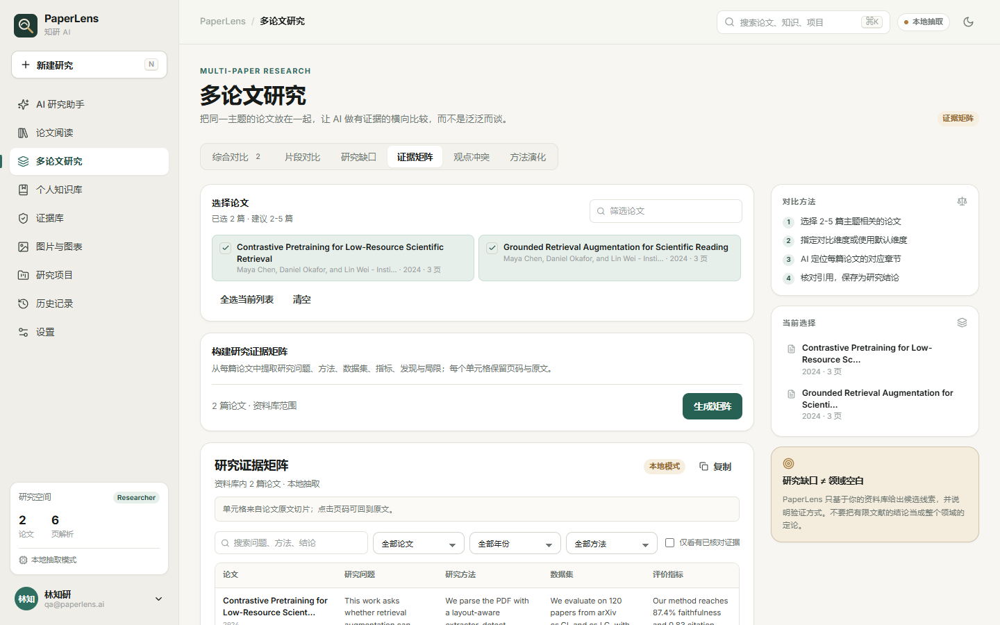
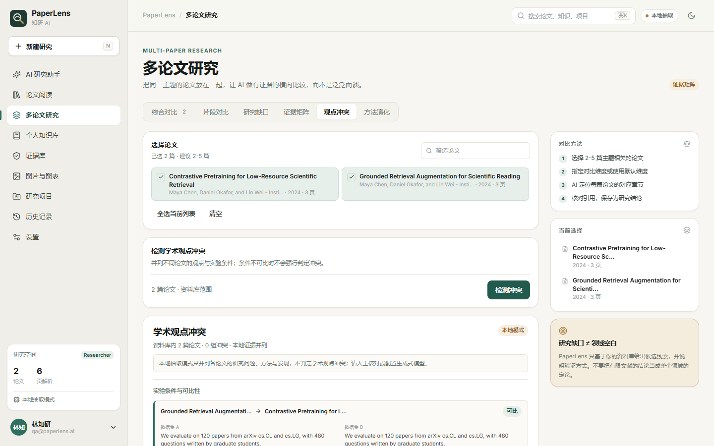
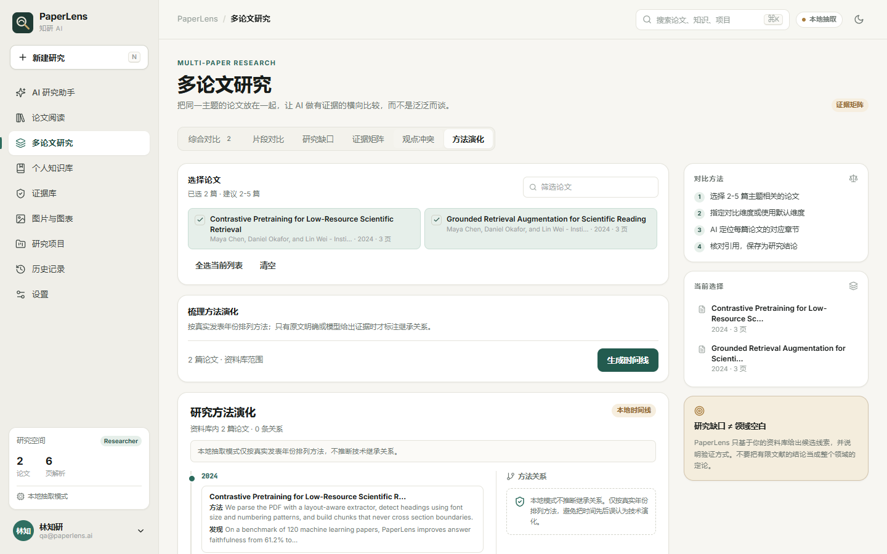
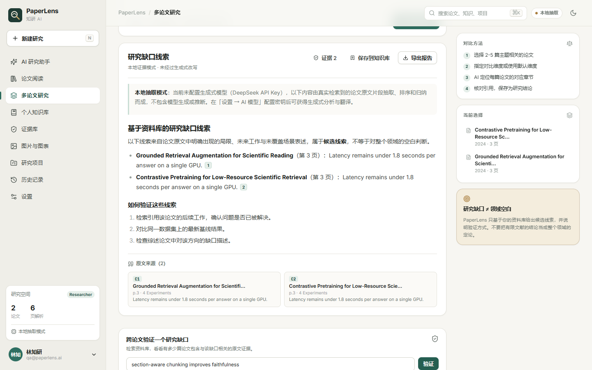

# 多论文研究 · P4

> 2026-11-04 · 基于 Evidence System 的结构化多论文分析
> 目标：让系统真正理解论文之间的关系，而不是增加更多“对比按钮”。



## 1. 核心变化

P3 之前，多论文页只有“综合对比 / 片段对比 / 研究缺口”三份长文本。
P4 增加 **结构化研究画像（Facets）** 与 **可查询的研究情报（Insights）**：

```
论文切片 ──▶ PaperFacet（六维画像 + 证据）
                 │
                 ├─ 证据矩阵（问题/方法/数据集/指标/发现/局限）
                 ├─ 观点冲突（可比性 + 条件 + 冲突）
                 ├─ 方法演化（时间线 + 关系）
                 └─ 研究缺口跨论文验证（证据覆盖）
```

每个单元格都保留页码、原文与核验状态；无法核对的单元格会显式标记。

## 2. PaperFacet：六维研究画像

| 维度 | 内容 | 本地抽取来源 | 模型输出 |
| --- | --- | --- | --- |
| research_question | 研究问题 | Abstract / Introduction 中含“we study/ask/?”的句子 | 严格 JSON + 引用 |
| method | 方法 | Method 章节 | 同上 |
| dataset | 数据集 | Experiment / Method 中匹配 dataset/benchmark/arXiv 等 | 同上 |
| metrics | 指标 | Experiment / Result 中匹配 accuracy/F1/%/latency 等 | 同上 |
| findings | 主要发现 | Result / Conclusion | 同上 |
| limitations | 局限性 | Limitation / Discussion / Future Work | 同上 |

- 本地模式：规则 + 句子抽取；每个字段创建 `evidence` 记录（source_type=facet）。
- 生成式模式：模型返回 `{text, quote, citation}`；quote 仍走本地原文核验；失败则回退本地字段。
- 每个字段包含：text、quote、page、section、chunk_id、evidence_id、verified。

## 3. 证据矩阵

界面支持：

- 论文筛选
- 年份筛选
- 方法筛选（按 method 文本）
- 关键词搜索（问题/方法/结论/标题）
- “仅看有已核对证据”
- 复制为 Markdown

单元格显示摘要、页码与核验状态；点击页码打开阅读器对应页。


## 4. 观点冲突

### 生成式模式

要求模型只输出 JSON，并满足：

1. 研究问题相同；
2. 数据集/指标可比较；
3. 至少一条编号证据；
4. 条件不同只能写“差异”，不能写“冲突”。

冲突卡片包含：观点 A/B、来源论文、证据、条件、严重程度、可比性。

### 本地模式（默认无 Key）

**不判定冲突。** 只提供：

- 两两论文的数据集/指标/条件对照；
- 可比性判断（同数据集且同指标才标“可比”）；
- 各论文的方法/发现/局限并列卡片。

这是刻意的：不同实验条件下的结果差异不能被当作学术冲突。



## 5. 方法演化

- **时间线**：只按真实发表年份排列论文，不把时间先后自动当成技术继承。
- **关系**：模型只能输出 `extends / improves / uses / compares / unknown`，并标注：
  - `explicit`：原文明确写了继承/改进/使用；
  - `possible`：基于证据的推测；
  - `unknown`：无法判断。
- **本地模式**：只给时间线，关系为空，明确提示“不推断”。



## 6. 研究缺口跨论文验证

在“研究缺口”结果下方输入一个缺口陈述，系统检索资料库：

- 返回有相关原文的论文数 / 总论文数；
- 每篇论文的相关证据（页码、章节、原文）；
- 强度：单篇 / 多篇 / 未覆盖。

**边界**：这是“检索相关度覆盖”，不是“论文明确支持该缺口”的语义判断；界面明确标注，需人工阅读。



## 7. API

| 方法 | 路径 | 说明 |
| --- | --- | --- |
| POST | `/research/matrix` | 生成/获取证据矩阵；body: `paper_ids, force` |
| POST | `/research/conflicts` | 冲突 + 条件可比性 |
| POST | `/research/evolution` | 时间线 + 方法关系 |
| POST | `/research/gap/validate` | 单个缺口的跨论文证据覆盖 |
| GET | `/research/insights` | 历史研究情报，可按 kind 筛选 |
| GET | `/research/insights/{id}` | 情报详情 |

所有结果持久化到 `research_insights`，图像/表格可复现；用户隔离。

## 8. 验收结果（2026-11-04）

| 项 | 结果 |
| --- | --- |
| 后端测试 | **43 passed**（新增 7 个 P4 测试） |
| 浏览器 | **29 步通过**，0 console/page error |
| 矩阵 | 2 篇 × 6 维，12 条证据引用，local=true |
| 冲突 | 0 组冲突，1 组可比性，local=true（不编造） |
| 演化 | 2 篇时间线，0 条关系，local=true（不推断） |
| 缺口验证 | 2/2 篇有相关证据，strength=multi |
| 持久化 | 12 条 insights（matrix/conflicts/evolution/gap_validation） |
| 证据覆盖 | 318 条证据，317 已核对，1 条因标点不一致标记未核对 |

复现：

```bash
cd backend
python -m pytest tests/test_multipaper.py -q
```

## 9. 已知边界

1. 本地 Facet 提取是启发式，复杂论文可能字段不准；需人工核对或配置模型。
2. 冲突/演化关系的自动生成依赖模型；本地模式只做证据并列，不假装完成语义判断。
3. 数据集/指标比较是文本级归一化，不做实体对齐；同一数据集的不同写法会判为不同。
4. 当前只基于资料库内论文，不接入外部学术数据源。
5. 尚无研究主题聚类/关系图（P5 Research Intelligence）。
6. `force=true` 会重新提取 facets，但旧证据保留（指纹去重）。

## 10. 下一步

P5 Research Intelligence 将直接复用：

- `PaperFacet` 六维画像；
- `ResearchInsight` 的矩阵/冲突/演化结果；
- `evidence` 的证据类型与核验；
- 项目/合集范围。

P5 应实现：研究全景、真实年份趋势、主题关系、研究机会、跨项目研究空间，并明确 `scope=library`。
